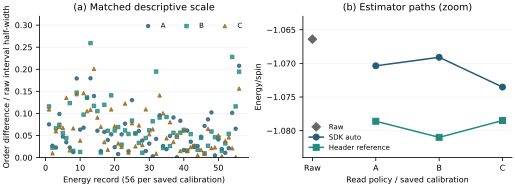
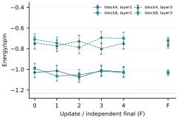

# Quantum measurement semantics: research artifact

Companion artifact for **Agent-Assisted Engineering and Measurement Semantics of a Variational Quantum Application**.

This repository provides a conventional physical-header readout reference, a credential-free synthetic example, derived historical data, and scripts that recompute the descriptive tables and figures. The evidence concerns one examined software stack. The alignment check connects physical measurement columns, integer-outcome bit positions and assignment-factor tensor axes.

## Run on a local CPU

The reported descriptive quantities can be recomputed with Python 3.9+ and its standard library:

```sh
python reproduce.py
```

This verifies the public file manifest and writes `outputs/recomputed_summary.json`. For the synthetic reference example and SVG figures, install the optional numerical dependencies in a virtual environment:

```sh
python -m pip install -r requirements.txt
python synthetic_example.py
python plot_results.py
```

There are no network, credential, provider-login or QPU submission operations in these scripts. `environment.json` records the two local environments used to run numerical and plotting paths; supported-version ranges are not a claim that every dependency combination was evaluated.

## Public contents

|Path|Purpose|
|---|---|
|`reference_readout.py`|Unmodified independent forward-channel/LU reference from the study|
|`synthetic_example.py`|Two-qubit synthetic illustration of opposite tensor orders; not native SDK execution|
|`reproduce.py`|Derived-data arithmetic, signed comparisons, update reconstruction, accounting and conditional precision projection|
|`plot_results.py`|Regenerate semantics and application SVG figures|
|`data/`|Derived numerical records with provider task IDs removed|
|`artifact/measurement_semantics/`|Evaluated package versions, native instrumentation hashes and pinned public source locations|
|`PROVENANCE.json`|Source digests and published-data derivation boundaries|
|`MANIFEST.json`|SHA-256 hashes of the publication files|

## Evidence figures





The first figure shows unchanged-record postprocessing. The second shows one historical campaign; its intervals omit SPAM and drift and do not demonstrate reliable training improvement.

## Main descriptive results

- 112 historical jobs under three saved calibrations yield 336 **conditional comparisons**, not 336 independent incidents. The public per-condition table has 336 rows.
- 56 energies under those calibrations yield 168 energy comparisons: 88 SDK-minus-header differences are positive and 80 negative. There is no common one-sided shift.
- The maximum absolute energy/spin difference is approximately 0.0119006; the matched raw interval half-width is 0.0459106. Calibration A/B/C maximum normalized ratios are approximately .2079/.2592/.2008.
- 48 update comparisons are evaluated at the original recorded parents. No gradient signs flip; the maximum coordinate difference is approximately .00193152 radians.
- Application-study accounting closes: **56832 requested = 50176 returned + 6656 failed-request shots**, across 173 identified jobs. Failed requests do not establish zero execution or zero billing. Earlier hardware-boundary scans are outside this subtotal.
- The 16-fold sampling example is a **conditional extrapolation** assuming the observed difference persists, calibration/distribution are stable and raw sampling intervals shrink as inverse square root. It is not a measured precision limit or a significance forecast.

## What can be reproduced

The public bundle supports recomputation of statistics from derived numerical tables, reconstruction of the tabulated updates, generation of the two evidence figures, and a synthetic algebra example. It preserves the distinction between measured raw energies, derived postprocessing, and hypothetical precision scaling.

**Full independent reproduction of the native 336-condition replay and the historical QPU execution requires the original joint shots, private calibration snapshots, and the original execution environment. Those inputs and compiled SDK binaries are not distributed here.** Consequently, the derived tables do not independently verify the correctness of the original acquisition or native fixture. A valid public analysis run is not a new hardware experiment.

## Evaluated-instance and interpretation boundaries

The evaluated versions and fixed public source locations are in [`artifact/measurement_semantics/`](artifact/measurement_semantics/README.md). The native replay used a temporary copy with one transport-scheme character changed for localhost archived responses. The original installed binary and system trust were unchanged. This was not an unmodified production-TLS replay; wheel-to-source build identity is not independently established.

The original training used raw decoding, and no contamination by the diagnosed automatic-mitigation path has been established. Raw versus automatically mitigated retrieval are different estimator policies, not by themselves bugs. Retrieval-time calibration is not a certified execution epoch. Maintainer classification as an implementation defect or contract/documentation ambiguity remains unconfirmed; no upstream issue has been published.

The reference is ordinary fixed-calibration linear algebra, not a newly invented mitigation algorithm. Short training does not demonstrate improved energy, comparative agent efficiency or autonomous LLM parameter control. This repository reports an engineering/reproducibility case study and its limitations.

## Data handling and reuse

Provider task IDs, credentials, account information, raw shot records, private calibration values and local absolute paths are excluded. Acquisition and energy aliases label related rows without exposing provider identifiers. Source SHA-256 values identify retained private evidence; they do not make those inputs public. Upstream code is referenced through pinned links; the repository does not redistribute the upstream SDK or patched binaries. No project-wide reuse license has been selected.
